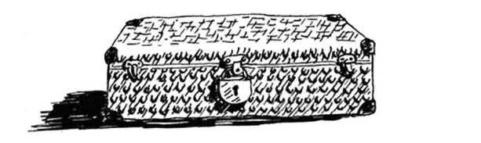
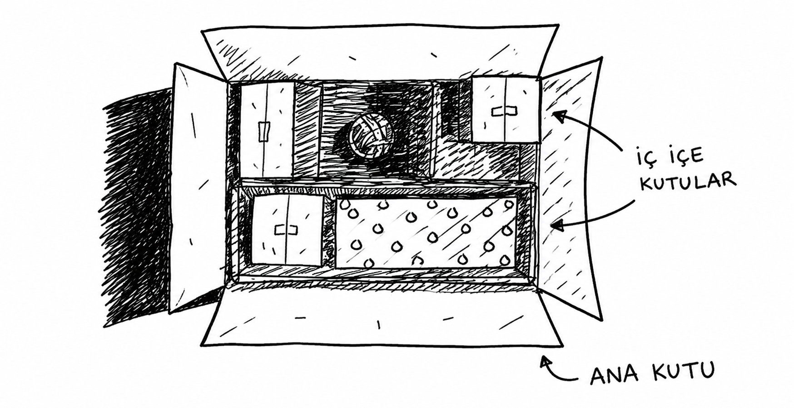
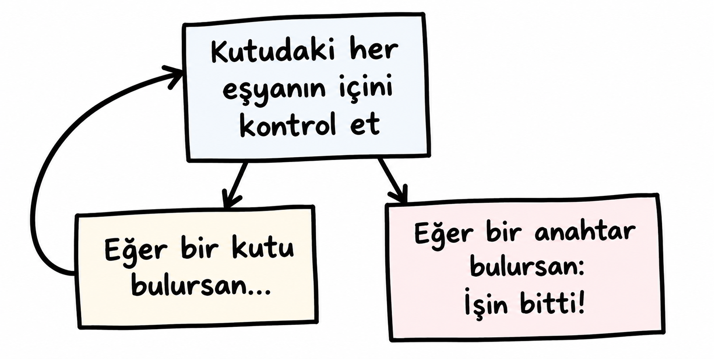

# Özyineleme

Diyelim ki büyükannenin tavan arasında gizemli kilitli bir bavul buldun.



Büyükannen sana bavulun anahtarının muhtemelen başka bir kutunun içinde
olduğunu söylüyor. O kutunun içinde daha fazla kutu, onların içinde de
başka kutular var.



**Anahtarı bulmak için algoritman ne olurdu?**

------------------------------------------------------------------------

## Yaklaşım 1 --- Döngü Kullanmak

**Görsel 1**


Bu yöntemde araman gereken kutulardan oluşan bir **yığın** oluşturursun.
Yığın boş olmadığı sürece bir kutu alır, içini inceler ve yeni kutular
bulursan onları tekrar yığına eklersin.

``` python
def look_for_key(main_box):
    pile = main_box.make_a_pile_to_look_through()

    while pile is not empty:
        box = pile.grab_a_box()

        for item in box:
            if item.is_a_box():
                pile.append(item)
            elif item.is_a_key():
                print("anahtar bulundu!")
```

------------------------------------------------------------------------

## Yaklaşım 2 --- Recursion Kullanmak

**Görsel 2**



Bu yöntemde bir kutu bulduğunda aynı fonksiyon tekrar çağrılır.

``` python
def look_for_key(box):
    for item in box:
        if item.is_a_box():
            look_for_key(item)
        elif item.is_a_key():
            print("anahtar bulundu!")
```

Her iki yöntem de aynı işi yapar. Recursion yalnızca çözümü daha
okunabilir hâle getirir; performans avantajı sağlamaz.

------------------------------------------------------------------------

# Temel Durum ve Recursive Durum

Yanlış yazılmış recursive fonksiyonlar sonsuz döngüye girebilir.

``` python
def countdown(i):
    print(i)
    countdown(i - 1)
```

Bu fonksiyon hiç durmaz.

## Doğru Hâli

``` python
def countdown(i):
    print(i)

    if i <= 0:      # Base Case
        return
    else:           # Recursive Case
        countdown(i - 1)
```

**Görsel 3 --- Sonsuz Döngü**


**Görsel 4 --- Base & Recursive Case**


------------------------------------------------------------------------

# Stack (Yığın)

Programlama boyunca aslında fark etmeden sürekli stack kullandın.

Bir yapılacaklar listesini üst üste dizilmiş yapışkan notlar gibi düşün:

-   **Push:** En üste ekle
-   **Pop:** En üsttekini oku ve çıkar

------------------------------------------------------------------------

# Call Stack (Çağrı Yığını)

Bilgisayar her fonksiyon çağrısı için bellekte ayrı bir kutu oluşturur.

``` python
def greet(name):
    print("hello")
    greet2(name)
    print("getting ready...")
    bye()

def greet2(name):
    print("how are you?")

def bye():
    print("ok bye!")
```

`greet("Maggie")` çağrıldığında:

1.  greet kutusu stack'e eklenir.
2.  greet2 çağrılır → ikinci kutu üstüne eklenir.
3.  greet2 biter → üst kutu çıkarılır.
4.  greet devam eder.
5.  bye çağrılır.
6.  bye biter.
7.  greet biter.

Yani fonksiyonlar **beklemez**, duraklatılır.

------------------------------------------------------------------------

# Recursion ve Call Stack

Factorial örneği:

``` python
def fact(x):
    if x == 1:
        return 1
    else:
        return x * fact(x - 1)
```

`fact(3)` çağrısı sırasında oluşan yığın:

**Görsel 5**


Önemli nokta:

> Her `fact` çağrısının kendine ait ayrı bir `x` değişkeni vardır.

Bir çağrının `x` değişkenine başka çağrı erişemez.

------------------------------------------------------------------------

## Dönüşler (Return)

**Görsel 6**


Dönüş sırası:

1.  `fact(1)` → 1 döndürür
2.  `fact(2)` → 2 × 1 = 2
3.  `fact(3)` → 3 × 2 = 6

Stack her zaman **LIFO (Last In First Out)** mantığıyla çalışır.

------------------------------------------------------------------------

# Kutular Yığını Aslında Stack'tir

Recursive örnekteki kutuların listesi aslında stack üzerinde tutulur.

**Görsel 7**


Her yarım kalmış fonksiyon çağrısı kendi kutularını saklar. Böylece
kutuları sen takip etmek zorunda kalmazsın; bunu call stack yapar.

------------------------------------------------------------------------

# Bellek Maliyeti

Stack kullanmanın avantajı kolaylıktır.

Ancak her fonksiyon çağrısı bellekte yer kaplar. Çok derin recursion
oluşursa stack büyür ve fazla bellek kullanılır.

İki çözüm vardır:

1.  Döngü (loop) kullanmak.
2.  Tail Recursion kullanmak (ileri seviye ve her dil desteklemez).

------------------------------------------------------------------------

# Alıştırmalar

## 3.1

Yalnızca bir call stack diyagramına bakarak hangi bilgileri
söyleyebilirsin?

## 3.2

Yanlışlıkla sonsuza kadar çalışan recursive bir fonksiyon yazarsan
stack'e ne olur?

------------------------------------------------------------------------

# Özet

-   Recursion, fonksiyonun kendisini çağırmasıdır.
-   Her recursive fonksiyonun **Base Case** ve **Recursive Case** bölümü
    vardır.
-   Stack'in iki işlemi vardır: **Push** ve **Pop**.
-   Tüm fonksiyon çağrıları **Call Stack** üzerine eklenir.
-   Derin recursion çok fazla bellek kullanabilir.

Sonuç olarak, işletim sistemleri bir araçtır ve bu araçlardan en az sorun çıkaranı ve işinize en çok yarayanı tercih etmek mantıklıdır. Linux, bazı kullanıcılar için hâlâ harika bir seçenek olabilir; ancak herkes için mükemmel bir çözüm olduğu iddiası pek gerçekçi değil.

